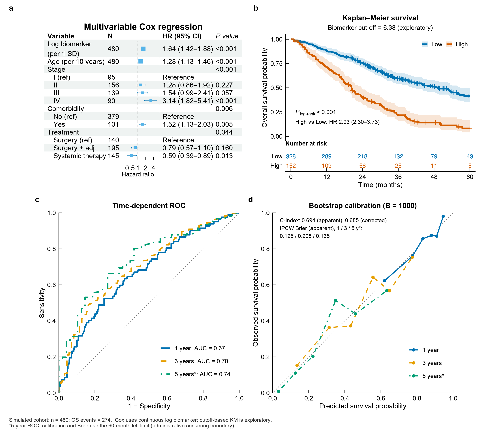

# Nature Figure 可编辑版

### 科研图同步输出 SVG 与原生可编辑 PPT，打开即可逐元素修改。

使用 **Python 或 R** 制作论文科研图。同时交付 **可编辑文字和各个元素的PPT版本。**

- **打开就能编辑**：文字、曲线、散点、柱形等均为独立原生对象，无需先取消组合。
- **两种格式，同一版式**：配套 SVG 与 PPTX，兼顾投稿和后期修改。
- **保留复现材料**：附绘图代码、相关源数据与检查记录。

## 开始使用

### 1. 安装 Skill

将完整的 `skills/nature-figure-editable/` 文件夹放入当前 Codex 环境的技能目录，保留资源与许可文件。本项目的已验证环境使用 `~/.codex/skills/`；其他版本请按其技能安装方式配置。

### 2. 告诉 AI 你要画什么

```text
使用 $nature-figure-editable，用 Python 绘制 3×2 科研组合图。
数据使用我提供的 CSV，输出 SVG 和所有元素已取消组合的可编辑 PPT。
请附可运行代码，并检查两种格式的版式是否一致。
```

也可指定 R，并补充图型、尺寸与配色；模拟数据须明确说明。

### 3. 推荐使用Codex运行

**这套 Skill 围绕 Codex 工作流打造。** 本页展示的案例，就是在 Codex 中完成绘图、原生可编辑 PPT 导出与检查的。推荐使用 Codex，沿用本项目已验证的运行方式和检查规范，减少跨平台适配，更方便继续改图。

#### GPT/Codex 会员开通指南

> [!TIP]
>
> **GPT/Codex 开通指南 2026：了解 ChatGPT 会员与 Codex 使用方案**
>
> 正规充值平台 **[ai66.org](https://ai66.org)**
>
> **✅ 支持支付宝/微信　｜　✅ 无需账号登录　｜　✅ 安全可靠**
>
> ### 👉 [前往 ai66.org 了解 GPT/Codex 开通方案](https://ai66.org)
>
> **推广说明**：ai66.org 的理念是“世界顶级 AI，国内人人皆可畅享”。通过官方合规支付链路开通会员，不触碰你的账号密码，不留后门。

### 4. 收到什么？

**SVG + 可编辑 PPTX + Python / R 源码 + 相关源数据与检查说明。** PNG、PDF、TIFF 按需增加。

## 看一个实际示例



[查看 SVG](assets/demo/clinical-figure.svg) · [下载可编辑 PPT](assets/demo/clinical-figure-editable.pptx)

**694 个独立原生对象 · 0 个组合 · 0 个图片对象。** 示例使用模拟数据，不作为临床证据。[查看结构检查记录](assets/demo/editability_qa.json)

<details>
<summary>运行条件、技术检查与已知限制</summary>

- 需要 Python / R、相关统计绘图依赖，以及可用的 PPT 制作与渲染工具；Skill 本身不是通用 SVG 转换器。
- 原生对象可编辑，不等于与 Excel 联动的 Office 图表；一条连续曲线可保留为一个路径对象。
- 显微照片、SEM、胶图等像素图不能拆成内部矢量元素，可经确认后保留图片与可编辑标注。
- 结构检查后仍需核对字体、数学符号、裁切、虚线和版式；统计结论需人工审核。
- 示例画布为 9 × 8 英寸，已做渲染检查，未声称在所有 PowerPoint 版本完成交互测试。临床示例的最佳截断值为探索性分析，5 年指标采用 60 月左极限，末期高风险校准存在稀疏随访限制。
- 若 PPT 制作为单独步骤，交付时说明环境与操作，不宣称仅运行绘图脚本就生成全部格式。

结构检查命令：

```bash
python skills/nature-figure-editable/scripts/audit_editability.py \
  --svg figure.svg --pptx figure_editable.pptx \
  --report editability_qa.json
```

</details>

---

第三方素材遵守其独立许可，见 [第三方说明](THIRD_PARTY_NOTICES.md)。本项目非 Nature 期刊官方产品，不代表其背书。

